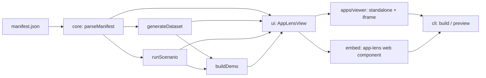

# AppLens: handoff notes

Read this first when picking the project up on another machine or in a new session.
Last updated: 2026-10-31, after **Phase 6**.

**On a new machine, do section 0 before anything else.**

For a full record of everything built so far and step-by-step instructions to rebuild it from scratch, see [REBUILD.md](REBUILD.md).

## 0. Start here: GitHub repo and pull request workflow

The repository is public at `bojanpetkovski18/app-lens`. `dev` is the default branch and `main` receives releases. Agent rules and verified commands are in [CLAUDE.md](CLAUDE.md), status is in [PROGRESS.md](PROGRESS.md), and decisions are in [DECISIONS.md](DECISIONS.md).

### 0.1 One-time setup on a new machine

1. **Install the tools:** Git and Node 22 LTS (see section 3).
2. **Clone and set your identity for this repository only** (see section 8):
   ```bash
   git clone https://github.com/bojanpetkovski18/app-lens.git
   cd app-lens
   git config user.name  "Your Name"
   git config user.email "you@personal-email.example"
   ```
3. **Check it works before committing anything:**
   ```bash
   npm ci
   npm run typecheck
   npm test
   npm run build
   ```

### 0.2 Rules for every piece of work

- **Start from an up-to-date `dev`:** `git switch dev; git pull; git switch -c "#00nn-three-to-seven-words"`.
- **Commit in small steps** with clear messages (`feat:`, `fix:`, `perf:`, `test:`, `docs:`, `chore:`, `ci:`).
- **Before pushing**, `npm run typecheck`, `npm test`, `npm run build` and `npm run e2e` must all pass.
- **Open a PR into `dev`.** The owner opens and merges PRs on GitHub. The description covers scope, changes, how to test, checks run, and security and privacy notes.
- **Update these in the same PR:** `PROGRESS.md`, `DECISIONS.md`, the status table in section 2, any changed commands or caveats, and Part A of [REBUILD.md](REBUILD.md).
- **Never** push directly to `main`, force-push a shared branch, or commit secrets.
- **To release:** merge `dev` into `main` through a PR, using a merge commit so the branches stay in step.

## 1. What AppLens is

AppLens lets any app show people what it does. The app owner writes one JSON **manifest** describing the app. It covers personas, data types, features, workflows and integrations. AppLens turns the manifest into an interactive showcase:

- an overview, a feature catalogue and a "who gets what" matrix
- a data explorer filled with **generated, fictional, deterministic** sample data
- step-by-step walkthroughs, plus an auto-generated **product demo video**

The showcase can be used in four ways: as a standalone site, inside an iframe, as an `<app-lens>` web component, or through the `app-lens` CLI.

It is a personal project. It must stay **independent of any employer or third-party code**. See section 8.

## 2. Status

| Phase | Scope | Branch | Status |
|---|---|---|---|
| 1. MVP | Manifest schema and validation, mock data engine, scenario runner, React viewer (Overview, Features, Data, Walkthroughs), persona switch, samples | `phase-1-2/foundation` | Merged into `dev` |
| 2. Distribution | `@app-lens/ui` shared package, theming (colours, radius, font, light/dark/auto), embedded mode, `<app-lens>` web component, iframe mode, standalone sites, CLI (`init`, `validate`, `build`, `preview`, `schema`), JSON Schema for editors, **product demo video** with a research-progress step | `phase-1-2/foundation` | Merged into `dev` |
| 3. Code review | Senior-developer review of the whole codebase; find and fix bugs of every severity, issues and performance problems; Node 22, vitest 4, CI | `phase-3/code-review` | Merged into `dev` |
| 4. Smarts | Import from OpenAPI, Prisma and README; PDF and Markdown export; analytics hooks; real video export; plus `lint`, `diff`, CSV/JSON record export and `preview --watch` | `phase-4/smarts` | Merged into `dev` |
| 5. Project intake | Attach a project as a local folder, a GitHub link or a published URL (e.g. `www.reddit.com`) and get a draft manifest | `phase-5/project-intake` | Merged into `dev` |
| 6. Studio | Visual manifest editor with live preview, optional AI drafting, `app-lens studio`, and a GitHub Pages workflow | `phase-6/studio` | Merged into `dev` |

Verified at the end of Phase 6: 304 unit tests pass (118 core, 126 CLI, 30 UI, 12 embed, 9 viewer, 9 studio), 29 Playwright e2e tests pass, typecheck passes in every package, `npm run build` succeeds and `npm audit` is clean. **AI drafting is tested with a fake client only: it has not been run against the live Claude API.**

## 3. Requirements and quick start

- Node **20.19+** is required. **Node 22 LTS is recommended** and is what CI uses.
- npm 10 (pnpm isn't needed).

```bash
npm install
npm run dev            # viewer with samples at http://localhost:5173
npm run dev:embed      # web component demo page (packages/embed/index.html)
npm run dev:studio     # Studio at http://localhost:5174, without the local server features
npm test               # all unit tests
npm run e2e            # Playwright, needs a build and `npx playwright install chromium`
npm run measure        # bundle sizes and generation time, needs a build
npm run typecheck      # all packages
npm run build          # viewer -> studio -> embed bundle -> cli (order matters)
npm run app-lens -- --help
```

Gotchas:
- `npm run dev -- --port X` does not work, because the extra argument becomes the Vite root. Use plain `npm run dev`.
- If two Vite versions get installed (TS2769 in `vite.config.ts`), run `npm dedupe`. The root `overrides` pins `vite 6.4.5`.
- After moving or renaming the folder, run `npm install` again. Workspace links are absolute junctions on Windows.

## 4. Repository layout

```
app-lens/
├─ packages/
│  ├─ core/      @app-lens/core   Pure TS: zod schema, validation, seeded mock data, scenario runner, demo builder
│  ├─ ui/        @app-lens/ui     React components + styles.css (all classes prefixed .al-, scoped to .al-root)
│  ├─ embed/     @app-lens/embed  <app-lens> custom element (Shadow DOM), Vite library build -> dist/app-lens.js
│  └─ cli/       @app-lens/cli    `app-lens` command; esbuild bundle + copies of viewer and embed builds
├─ apps/viewer/  @app-lens/viewer Standalone/iframe viewer app (Vite, base './')
├─ apps/studio/  @app-lens/studio Manifest editor with live preview
├─ samples/      *.app-lens.json  Fictional sample apps (InvoiceFlow, TaskPilot), bundled into the viewer
├─ HANDOFF.md
└─ package.json  npm workspaces, root scripts, vite override
```



Key files:
- **Schema and types:** [packages/core/src/schema.ts](packages/core/src/schema.ts)
- **Reference checks:** [packages/core/src/validate.ts](packages/core/src/validate.ts)
- **Field kinds and generators:** [packages/core/src/fields.ts](packages/core/src/fields.ts)
- **Dataset, ordering and display labels:** [packages/core/src/generator.ts](packages/core/src/generator.ts)
- **Walkthrough engine:** [packages/core/src/scenario.ts](packages/core/src/scenario.ts)
- **Demo script builder (feature ranking, scenes, timeline helpers):** [packages/core/src/demo.ts](packages/core/src/demo.ts)
- **Demo research step and video player:** [packages/ui/src/components/DemoTheater.tsx](packages/ui/src/components/DemoTheater.tsx)
- **Scene rendering for the demo video:** [packages/ui/src/components/DemoScenes.tsx](packages/ui/src/components/DemoScenes.tsx)
- **Theming and `Frame`:** [packages/ui/src/theme.tsx](packages/ui/src/theme.tsx)
- **Web component:** [packages/embed/src/index.tsx](packages/embed/src/index.tsx)
- **CLI:** [packages/cli/src/commands.ts](packages/cli/src/commands.ts)

## 5. Manifest reference

Top-level keys: `app` (required), `attribution`, `draft`, `personas`, `entities`, `features`, `scenarios`, `integrations`, `mock`. `draft` marks a manifest drafted from a project you do not own.
Unknown keys are rejected. `app-lens init` writes `app-lens.schema.json` so editors can autocomplete.

**Field kinds** (`"field": "kind:args"`):
- **Identifiers and links:** `id`, `seq:INV-####`, `ref:Entity`
- **Choices and constants:** `enum:a,b,c`, `const:value`
- **Numbers:** `int:1..10`, `float:0..1`, `money:10..500`, `percent:0..100`
- **Booleans and dates:** `bool`, `date:-30..30`, `datetime:-7..0` (offsets in days from `mock.baseDate`, which defaults to today, limited to ±100000 days)
- **People and organisations:** `fullName`, `firstName`, `lastName`, `email`, `phone`, `company`, `jobTitle`, `city`, `country`
- **Text:** `codename`, `title`, `word`, `words:2..4`, `sentence:6..12`, `paragraph:2..4`

**Fake data rules:**
- Emails use only `example.com/.org/.net` or `<company>.example`.
- Phone numbers use the fictional `555-01xx` range.
- `ref` targets are generated first. Self-references work, but cycles between entities are rejected.

**Scenario steps:** `create` (with `values`), `select` (with `where`), `update` (with `set`), `delete`, `note`. Values can use `$today` and `$now`, must match the field kind, and can be `null`.

**Theme** (`app.theme`): `primary`, `accent` (hex), `mode` (`light|dark|auto`), `radius` (0–24), `font` (a plain font stack).
Hosts can override these with attributes or URL parameters. All values are sanitised.

## 6. Using AppLens in other apps

**Web component**
```html
<script src="app-lens.js"></script>
<app-lens src="manifest.json" theme="auto" primary="#0f766e" tab="scenarios" persona="lead"></app-lens>
```
Other ways to supply the manifest:
- set it from script: `el.manifest = object`
- put inline JSON inside the element: `<script type="application/json">`

The element emits `app-lens:ready` for a valid manifest and `app-lens:error` for a failed load or an invalid manifest (`detail.issues` lists the problems). Its styles stay inside the Shadow DOM.

**Iframe**
```html
<iframe id="lens" src="https://host/app-lens-site/?embed=1&theme=dark&tab=features" style="width:100%;border:0"></iframe>
<script>
  addEventListener('message', (e) => {
    if (e.data?.type === 'app-lens:resize') document.getElementById('lens').style.height = e.data.height + 'px';
  });
</script>
```
Supported URL parameters (a built site is pinned to its own manifest, so it ignores `manifest` and `source`):
- `manifest`
- `source`
- `embed=1`
- `theme`
- `primary` (URL-encode `#` as `%23`)
- `accent`
- `radius`
- `font`
- `tab`
- `persona`

**CLI**
```bash
app-lens init app-lens.json --name "My App"
app-lens validate app-lens.json
app-lens build app-lens.json --out app-lens-site   # index.html + manifest.json + app-lens.js
app-lens preview app-lens.json                     # build to temp + serve on 127.0.0.1:4317
```
`build` refuses to write into a non-empty folder it didn't create unless you pass `--force`. It never deletes files.

```bash
app-lens preview app-lens.json --watch             # rebuild and reload the page on save
app-lens lint app-lens.json --min-score 80         # score it, and fail CI below 80
app-lens diff old.json new.json                    # what changed
app-lens ingest openapi spec.yaml --out draft.json # also: prisma, readme
app-lens export pdf app-lens.json                  # also: md, with a Mermaid data model
```

**Project intake.** One command, three sources, detected automatically:

```bash
app-lens attach ./my-project
app-lens attach https://github.com/owner/repo/tree/branch/folder
app-lens attach www.example.com
# --out --report --max-files --max-pages --dry-run --json
# --own        this URL or repo is mine, so no third-party marking
# --third-party  this folder is someone else's
```

The output is a validated draft plus `app-lens.intake.json`, which lists each item with its evidence and a confidence level. URLs and repos count as third-party unless you pass `--own`: their drafts go to the gitignored `drafts/` folder, carry a not-affiliated notice and a `draft` marker, and `build` refuses them. The viewer's *Attach project* dialog reads folders entirely in the browser. GitHub links and websites need the dev server's `/__app-lens/attach` endpoint, or the CLI.

**Studio.** `app-lens studio [file]` opens a form and JSON editor with a live preview on 127.0.0.1:4318. It shows validation problems you can click to jump to, a quality score, suggestions and undo/redo. With a file it loads and saves that file, and it only saves valid manifests. Without one it autosaves in the browser. Attach and AI drafts both appear as a list of changes to apply or discard.

**AI drafting (optional).** `app-lens ingest readme README.md --ai`, or *Draft with AI* in Studio, sends the text to the Claude API using the official SDK and `claude-opus-5-5`, with server-side refusal fallbacks enabled. It needs `ANTHROPIC_API_KEY` and costs money per run. Replies are validated with `parseManifest`, and problems are sent back up to twice. A person reviews the result.

**Analytics.** Nothing is tracked by default. Pass `onEvent` to `AppLensView`, listen for the `app-lens:event` DOM event on the web component, or listen for `{ type: 'app-lens:event', event }` messages from an iframe. Events: `tab_viewed`, `persona_changed`, `feature_viewed`, `scenario_completed`, `demo_completed`.

## 7. Product demo (Walkthroughs → "Product demo")

1. **Poster:** the user clicks *Generate demo*.
2. **Research step:** a progress bar and six stages run: reading the profile, finding personas, ranking features, mapping the data model, scripting workflows, rendering. Each stage reveals what it found, taken from `script.findings`. It takes about 6 seconds, or about 1.5 seconds with reduced motion.
3. **Video:** an animated, video-like player built from `buildDemo`. Scenes are intro, personas, the top 4 features, data model, up to 2 workflows, and outro.
   - It has play/pause, seek, chapters, keyboard controls (Space, ←/→) and fullscreen.
   - Visuals are derived from elapsed time, so pausing and seeking stay in sync.
   - A demo already researched for a manifest, persona and seed skips the research step for the rest of the session.

Feature ranking is in `rankFeatures`. It scores highlights, linked entities, description, whether the feature is core (no tier), and persona match.

## 8. Independence, privacy and security rules (keep these)

- **No employer or third-party code, data, names or config goes into AppLens.** Samples stay fictional.
- **Manifests about apps you don't own never go into `samples/` or a build.**
- **Ownership:** keep the project in a personal repo on a personal device, with a licence in your name.
- **Security measures already in place:**
  - Only http(s) URLs are allowed in manifests, which blocks `javascript:` links.
  - Theme values from attributes and URL parameters are sanitised.
  - Manifest fetches use `credentials: 'omit'`.
  - No `dangerouslySetInnerHTML` is used anywhere.
  - CLI output is HTML-escaped, with a function replacer so `$&` in a name stays literal.
  - Static serving is protected against path traversal and binds to loopback only.
  - Size limits on counts and fields prevent manifests that freeze the browser.
  - Manifest names resolve through own properties only, so `constructor` never reaches `Object.prototype`.
  - Built sites ship a content security policy, and a pinned site ignores `?manifest=` so a link cannot spoof its content.
  - The preview server checks the `Host` header to block DNS rebinding.
  - Intake never runs project code, skips secrets and key files, and does not follow symlinks.
  - Website intake blocks non-public addresses on every redirect and connects to the checked address, so a second DNS answer cannot change the target. It respects `robots.txt` and collects page structure only, never body text.
  - The Studio API needs a loopback `Host`, and writes also need a matching `Origin` and a JSON content type. It binds to 127.0.0.1 and has no authentication, so don't expose it.
  - Source text sent to Claude is delimited and marked as untrusted, and over-long input is refused rather than cut.
  - GitHub tarballs are parsed by hand: traversal paths abort the extraction, links are never created, and sizes are capped. `GITHUB_TOKEN` is only sent to the GitHub API.

## 9. Known issues and caveats

- Generating the largest allowed manifest (15,000 records with 40 fields) takes about 1.4 seconds on the main thread. Typical manifests take a few milliseconds. A worker could remove the pause if real manifests get that large.
- Repeat builds into the same folder leave old hashed assets behind, because `build` never deletes files.
- `app-lens:resize` posts to `'*'` on purpose: the viewer can't know its embedder, and the message only carries a height.
- Validation runs in two stages. If the schema stage fails, reference checks (unknown refs, personas) are only reported after those errors are fixed.
- The on-screen demo is a rendered animation. "Download video" records a separate canvas render to WebM in real time, so it takes as long as the demo. MP4 is not produced.
- Sites that render everything with JavaScript give thin drafts, because intake never runs scripts. A headless mode could come later behind a flag.
- A folder with a plain README and no routes, specs or schemas gives a thin draft. Monorepos only read the root README and `package.json`.
- Walkthroughs are edited in Studio's JSON tab, not the form.
- The Studio preview runs at full speed on every valid edit, so very large manifests will feel slow.
- The GitHub Pages deployment needs *Settings → Pages → Source: GitHub Actions*. Studio there has no local server, so Save, GitHub and website attach, and AI drafting are unavailable. Folder attach works.
- PDF export uses the built-in Helvetica font, so text outside Latin is transliterated or replaced with `?`.
- The `app-lens.mjs` (ES) embed build is not minified; `app-lens.js` (IIFE) is.
- The viewer bundles samples at build time, so new samples need a rebuild.

## 10. Next steps

**Housekeeping (do first on a new machine)**
1. Done: the GitHub repo exists, with everything through Phase 6 merged into `dev`.
2. Done: Phase 3 is on `phase-3/code-review`.

**Phase 3: Code review (senior software developer)**

The agent acts as a **senior software developer** reviewing the whole codebase, as if it were someone else's code before a release. It looks for bugs of **every severity**, other issues and performance problems, and then **fixes them**. Branch `phase-3/code-review`.

1. **Baseline first.** Run `npm install`, `npm run typecheck`, `npm test`, `npm run build` and `npm audit`. Record the test count, build time, bundle sizes (`apps/viewer/dist`, `packages/embed/dist/app-lens.js`) and generation time for a large manifest (high `mock` counts). The same numbers are measured again at the end.
2. **Read every file** in `packages/core`, `packages/ui`, `packages/embed`, `packages/cli` and `apps/viewer`. Use this checklist:
   - **Correctness:** logic errors, off-by-one errors (e.g. `seq` patterns), empty or minimal manifests, zero and maximum counts, self-references and ref cycles, `baseDate` and time-zone handling, determinism (same seed gives the same output), scenario steps on missing rows, persona filtering.
   - **Security:** re-check every measure in section 8. Look for XSS paths, unsafe URLs, prototype pollution (`__proto__`, `constructor` keys in manifests), ReDoS in regular expressions, path traversal in `preview`, HTML escaping in `build`, `postMessage` usage (target origin, validating incoming messages), and dependency advisories.
   - **Performance:** algorithmic cost in the generator and scenario runner, repeated manifest parsing or dataset generation, React re-renders (missing `useMemo`/`useCallback`, unstable keys), large tables in the data explorer (paginate or virtualise), the demo player's `requestAnimationFrame` loop, bundle size and duplicated dependencies, style injection in the Shadow DOM.
   - **Reliability:** effects that never clean up (timers, rAF, event listeners, fetches without `AbortController`), the web component unmounting React in `disconnectedCallback`, attribute changes after mount, fetch and parse errors shown to the user instead of a blank screen, CLI exit codes.
   - **Accessibility:** keyboard navigation, focus handling in the demo player and tabs, ARIA roles and labels, contrast in light and dark mode, `prefers-reduced-motion`.
   - **Code quality:** `any` and unsafe casts, dead code, duplicated logic, unclear names, inconsistent error messages, convention breaks from section 11.
   - **Tests:** missing coverage for the cases above. `packages/ui` and `packages/embed` currently have no tests.
   - **Tooling:** move to Node 22 LTS, upgrade vitest to 4 (fixes the advisories in section 9), get `npm audit` clean, and add CI (GitHub Actions running `npm ci && npm run typecheck && npm test && npm run build` on every PR).
3. **Rate every finding:**
   - **Critical:** security hole, third-party data reaching a build, or a crash on a valid manifest.
   - **High:** wrong output, broken feature, or a severe performance problem.
   - **Medium:** edge-case bug, accessibility blocker, or noticeable slowness.
   - **Low:** code quality, minor UX, or a small inefficiency.
4. **Fix in order:** Critical, then High, Medium, Low. Each fix gets its own commit (`fix:`, `perf:`, `refactor:`) and, where testable, a regression test that fails before the fix. No unrelated refactors. If a fix is large, risky or changes the manifest format, describe it and ask the user first.
5. **Measure again** and compare with the baseline. Performance must not get worse anywhere.
6. **Report in the PR description:** a findings table (ID, severity, area, file, problem, fix, test), the before/after numbers, and anything deliberately left open with a reason. Move remaining open items into section 9 of this file.

Done when: no Critical or High findings remain open, all tests pass (more than the current 46), typecheck and build pass, `npm audit` is clean or each remaining advisory is explained, CI runs on the PR, and section 9 is up to date.

Tip: repeat a lighter version of this review at the end of every later phase, before opening its PR.

**Phase 4: Smarts**
1. `app-lens ingest openapi <spec>`: map schemas to `entities` (string formats to field kinds, `$ref` to `ref:`) and tags/operations to `features`. Produce a draft manifest and validate it.
2. `app-lens ingest prisma <schema.prisma>`: map models to entities and relations to `ref:`.
3. `app-lens ingest readme <README.md>`: take headings and bullets as draft features. Keep it heuristic; add AI behind a flag later.
4. Export: `app-lens export md|pdf`, a one-pager built from the same data as the overview (PDF via print CSS or a headless browser).
5. Analytics hooks: `onEvent` callback and DOM events (`app-lens:event` with `feature_viewed`, `scenario_completed`, `demo_completed`). No tracking by default.
6. Real video export: record the demo player with `MediaRecorder` (canvas or `getDisplayMedia`) into WebM, or render frames headlessly.
7. A `--watch` flag for `app-lens preview` that rebuilds when the manifest changes.

**Phase 5: Project intake**

Goal: point AppLens at an existing project and get a validated **draft** manifest plus a report of what was found. One command, three source types, auto-detected:

```bash
app-lens attach ./my-project                       # local folder
app-lens attach https://github.com/owner/repo      # GitHub link (also /tree/<branch>/<subdir>)
app-lens attach www.reddit.com                     # published site; bare hosts get https://
# common flags: --out <file>  --report <file>  --max-files N  --max-pages N  --dry-run
```

Architecture:
- **Pure core:** add `packages/core/src/intake.ts` with a `ProjectSignals` type (app name, description, theme colours, routes/pages, forms and fields, API schemas, data models, README sections) and `draftManifest(signals)`. No I/O, so it stays testable and deterministic.
- **Adapters in the CLI:** `packages/cli/src/intake/folder.ts`, `github.ts`, `site.ts`. Each one only collects `ProjectSignals`; all mapping logic lives in core.
- **Reuse Phase 4:** any OpenAPI, Prisma or README file found in a folder or repo goes through the Phase 4 importers, so intake is mostly orchestration.
- **Output:** a draft manifest that passes `parseManifest`, and an `app-lens.intake.json` report listing each entity, feature and persona with its evidence (file path or page URL) and a confidence level. The user reviews before using it.

1. **Folder source**
   - Walk read-only. Honour `.gitignore`; always skip `node_modules`, `dist`, `build`, `.git`, `.env*`, keys and certificates.
   - Cap file count, file size and total bytes. Do not follow symlinks outside the root.
   - Never run project code: no `npm install`, no scripts, no `require`/`import` of project files.
   - Signals: `package.json` (name, description), README, `openapi.*`/`swagger.*`, `schema.prisma`, route folders (`pages/`, `app/`, `routes/`), form components, Tailwind/CSS theme colours.
2. **GitHub source**
   - Parse strictly: only `https://github.com/<owner>/<repo>[/tree/<ref>[/<path>]]`, with owner/repo/ref validated against an allow-list pattern.
   - Download the tarball through the GitHub REST API (no `git clone`) into a temp folder, then reuse the folder adapter.
   - Guard extraction against path traversal and symlinks, cap the archive size, and delete the temp folder afterwards.
   - Public repos by default. Optional `GITHUB_TOKEN` from the environment for private repos and rate limits; never log it or write it anywhere.
3. **Published URL source**
   - Normalise bare hosts (`www.reddit.com` becomes `https://www.reddit.com/`). Only http(s).
   - **SSRF guard:** resolve DNS and block loopback, private, link-local and metadata addresses; re-check on every redirect; cap redirects, timeout and response size.
   - Respect `robots.txt`. Send a clear `User-Agent`. No cookies, no login, no JavaScript execution (an optional headless-browser mode can come later behind a flag).
   - Crawl the home page, `sitemap.xml` and a capped number of same-origin pages. Signals: `<title>`, meta and Open Graph tags, `manifest.webmanifest` (name, theme colour), navigation links (features), headings, and forms (entities and field kinds).
   - **Structure only:** never copy real user content (posts, names, emails) into the manifest. Sample data stays generated and fictional.
4. **Third-party projects (section 8 applies)**
   - If the source is not the user's own project (any URL or repo they don't own), write the output to a gitignored `drafts/` folder by default (add it to `.gitignore` in this PR) and fill `attribution` with the source and a not-affiliated notice.
   - Add a test that intake output for a third-party source never lands in `samples/` or in build output.
5. **Viewer entry point**
   - An "Attach project" dialog with three tabs: Folder, GitHub link, Website URL.
   - Folder can run fully in the browser (`<input webkitdirectory>` or `showDirectoryPicker`) through the same core mapping.
   - GitHub and URL need server-side fetching (CORS and SSRF), so route them through a dev-server-only endpoint (`/__app-lens/attach`, `apply: 'serve'`, loopback only) or tell the user to run the CLI.
6. **Tests**
   - Core: `draftManifest` on fixture signals produces a valid manifest.
   - Folder: a fixture project under `packages/cli/test/fixtures`.
   - GitHub: a mocked API and a hand-built tarball, including a path-traversal entry that must be rejected.
   - URL: a local HTTP server with an injected resolver for tests, plus unit tests that the SSRF guard blocks `127.0.0.1`, `10.x`, `169.254.169.254` and `[::1]`.

Done when: all three sources produce a manifest that passes `app-lens validate`, the report lists evidence for every item, the security tests pass, and no third-party output reaches a build.

**Phase 6: Studio**
1. `apps/studio`: a form plus JSON editor for manifests with a live `AppLensView` preview, inline validation messages (from `parseManifest`) and the demo player. Use Phase 5 "Attach project" as the starting point.
2. Optional AI-assisted drafting from a README or OpenAPI spec, with a human review step.

**Publishing (when ready)**
- Choose an npm scope you own, remove `"private": true` from the packages you want to publish, and add build outputs and `files` fields for `core`, `ui` and `embed`. The CLI already bundles its dependencies.

## 11. Conventions

- **Strict TypeScript** across all packages.
- **Pure core:** no DOM or Node APIs in `packages/core/src`.
- **Deterministic data:** the same manifest, seed and `baseDate` always produce the same data. Use `rng.fork(label)` for new random streams.
- **CSS:** every class starts with `al-` and is scoped under `.al-root`, so it never leaks into a host page. Colours come from CSS variables so dark mode keeps working.
- **Untrusted input:** treat manifests, attributes and URL parameters as untrusted and validate them at the boundary.
- **Tests:** add a test for new manifest features in `packages/core/test`.

