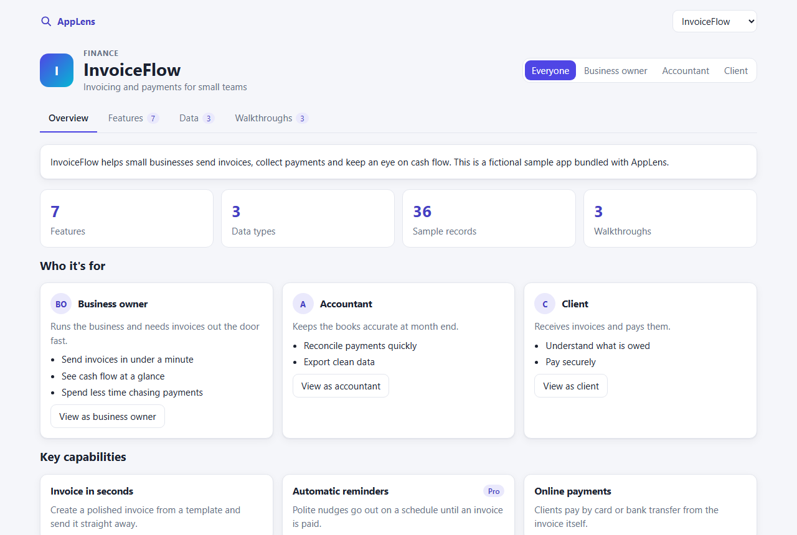
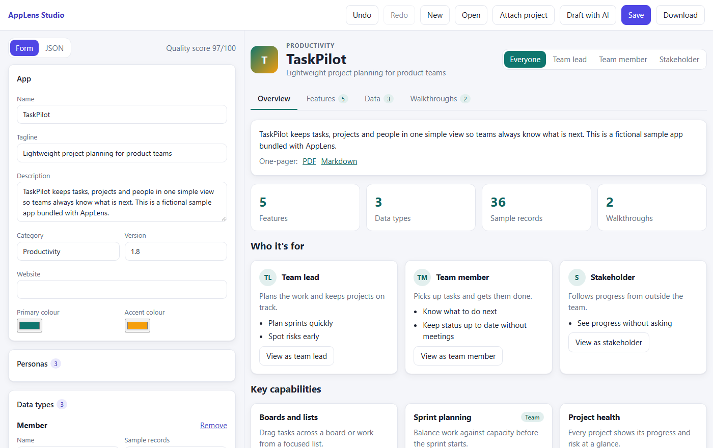

# AppLens

Let any app show people what it does. Describe your app in one JSON **manifest**, or point AppLens at an existing project, and get an interactive showcase:

- an overview, a feature catalogue and a "who gets what" matrix
- a data explorer filled with **generated, fictional, deterministic** sample data
- step-by-step walkthroughs and an auto-generated product demo you can download as a video
- a one-page PDF or Markdown summary

Use the result as a standalone site, inside an iframe, as an `<app-lens>` web component, or through the `app-lens` CLI.



## Quick start

Requires Node 20.19 or later (22 LTS recommended) and npm 10 or later.

```bash
npm install
npm run build
npm run dev            # viewer with the sample apps at http://localhost:5173
```

The commands below show `app-lens`. From this repository, run them as `npm run app-lens -- <command>`.

## Start from what you already have

```bash
app-lens attach ./my-project                    # a local folder
app-lens attach https://github.com/owner/repo   # a GitHub repository
app-lens attach www.example.com                 # a published site
app-lens ingest openapi spec.yaml               # also: prisma, readme
```

You get a validated draft plus a report showing where each item came from. Project code is never run, secrets are never read, and only the structure of a website is collected. Drafts of projects you don't own are marked and can't be built.

## Edit it in Studio

```bash
app-lens studio app-lens.json
```

Studio is a form and JSON editor with a live preview, clickable validation problems, a quality score and undo/redo. It can also draft a manifest with Claude from a README or OpenAPI spec if you set `ANTHROPIC_API_KEY`. You review every draft before it's applied.



## Publish it

```bash
app-lens validate app-lens.json
app-lens lint app-lens.json --min-score 80      # score it, and fail CI below 80
app-lens preview app-lens.json --watch          # rebuild and reload on save
app-lens build app-lens.json --out site         # a static site
app-lens export pdf app-lens.json               # a one-pager
app-lens diff old.json new.json                 # what changed
```

Or embed it:

```html
<script src="app-lens.js"></script>
<app-lens src="manifest.json" theme="auto" primary="#0f766e" tab="scenarios"></app-lens>
```

## Project layout

| Path | What it is |
|---|---|
| `packages/core` | Pure TypeScript: schema, validation, mock data, scenarios, demo script, importers, export |
| `packages/ui` | React components and styles |
| `packages/embed` | The `<app-lens>` web component |
| `packages/cli` | The `app-lens` command |
| `apps/viewer` | Standalone and iframe viewer |
| `apps/studio` | Manifest editor |

## Development

```bash
npm run typecheck
npm test
npm run build
npx playwright install chromium && npm run e2e
```

## Documentation

- [HANDOFF.md](HANDOFF.md): project status, workflow and full manifest reference
- [REBUILD.md](REBUILD.md): complete build record
- [docs/ARCHITECTURE.md](docs/ARCHITECTURE.md): how it works
- [docs/AUDIT.md](docs/AUDIT.md): accessibility and polish audit
- [PROGRESS.md](PROGRESS.md) and [DECISIONS.md](DECISIONS.md): status, measured results and why things are built this way

## Built with AI assistance

AppLens was built with AI assistance, using Claude Code. All sample apps and generated data are fictional.

## Licence

[MIT](LICENSE)
